# 签署日报：每日进展、基线文件与图表配色使用说明

适用版本：签署日报插件 0.7.1 及以上。入口：左侧导航「签署日报」。

本文讲三件新功能怎么用：

1. [本地导入报表后看每日进展](#一本地导入报表看每日进展)（今天比上次签署率涨了多少、每张单少了几个人没签、新签完几张单）
2. [指定一份文件作为固定的对比基线](#三指定基线文件)（程序自动留备份）
3. [调整图表颜色](#四调整图表颜色)

> 关于截图：下面的截图是在测试机上用**样例数据**截的，路径是测试机的样子
> （`/tmp/...`）。在你的 Windows 电脑上，路径会是 `D:\报表\...` 这样的形式，其余界面相同。

---

## 一、本地导入报表，看每日进展

### 最简单的用法：每天导入一次

**第一天**

1. 从 TDC 导出「数模设计审核流程」报表（`.xlsx`；如果文件受加密保护，用 Excel 另存为「Unicode 文本(*.txt)」）。
2. 打开「签署日报」，展开「用本地导出的报表生成」。
3. 点「报表文件」选中刚导出的文件。
4. 核对「数据截至日期」。它默认填今天；如果这份报表不是今天导出的，改成导出那天。
5. 保持「留作下次对比」勾选，点「用这份报表生成」。

第一次导入没有可比的数据，按钮上方会写「这是第一次导入，明天起才能看到每日进展」：

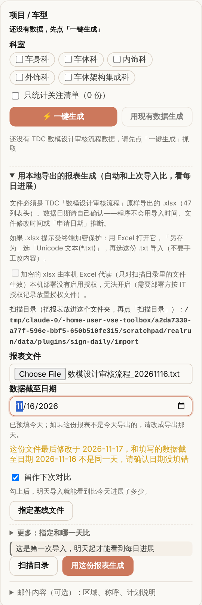

生成后，结果顶部会说明这次没有对比、已留作下次对比：

**第二天起**

重复同样的步骤。选好文件后，按钮上方会直接告诉你这次会和哪一天比：

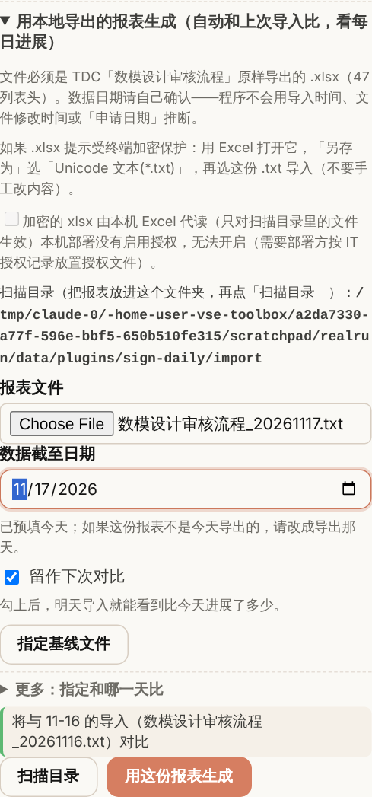

点「用这份报表生成」后，结果顶部说明实际和哪一份比了：

### 每日进展怎么读

正文最前面多了「每日进展」一段，复制正文时会一起带上：

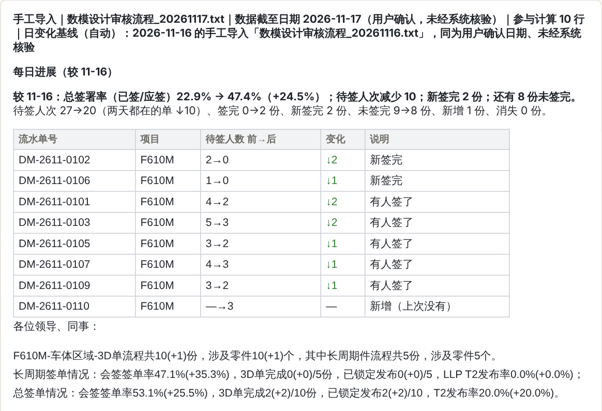

| 位置 | 含义 |
| --- | --- |
| 第一句（加粗） | 一眼结论：总签署率从多少到多少、待签人次减少多少、新签完几份、还有几份未签完 |
| 第二句 | 明细数：待签人次、签完份数、未签完份数的前后值，以及新增、消失的单数 |
| 表格 | 只列有变化的单：待签人数「前→后」、变化（↓ 表示少了几个人没签）、说明 |
| 汇总段里的括号 | 如 `53.1%(+25.5%)`，是会签签单率等指标较上次的增减 |

几点说明：

- **总签署率**是全部单的「已签人数 ÷ 应签人数」，和汇总段里的「会签签单率」不是同一个数。
- 表格排序：新签完的在最前，其次是待签减少最多的，然后是待签变多的（加签或退回），最后是新增的单。
- 「消失」的单是指上次有、这次导出里没有的单。**两次导出要用同样的 TDC 筛选条件**，否则少导出的单会被算成消失。
- 完全没有变化时，会写「与 MM-DD 相比没有变化」。

### 常见提示

**日期和文件对不上**

选中的文件最后修改日期和填的日期不是同一天时，会出现黄色提醒。它只是提醒，不会替你改日期：

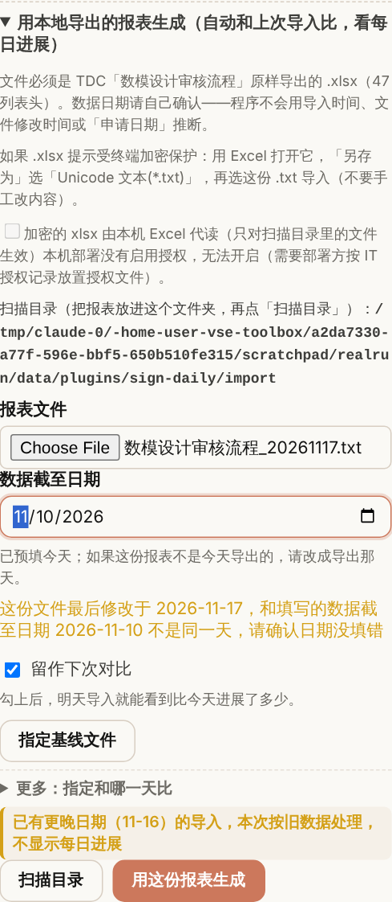

**其它情况**

| 按钮上方的提示 | 原因 | 怎么办 |
| --- | --- | --- |
| 这是第一次导入，明天起才能看到每日进展 | 之前没有导入过 | 正常，照常生成 |
| 已有更晚日期的导入，本次按旧数据处理 | 填的日期比已导入过的日期早 | 检查日期是否填错；确实要重看旧数据时照常生成，只是不显示进展 |
| 上次导入是 MM-DD，隔了超过 14 天，这次不自动比 | 两次导入间隔太久 | 需要对比的话，在「更多」里指定那一天，或使用基线文件 |
| 数据截至日期晚于今天 | 日期填成了未来 | 改成正确日期 |

**报表受公司终端加密保护，读不了**

两种办法，任选其一：

- 用 Excel 打开报表，另存为「Unicode 文本(*.txt)」，再用「报表文件」导入这份 txt。
- 勾选「加密的 xlsx 由本机 Excel 代读」，把加密的 xlsx 放进页面上写着的扫描目录，点「扫描目录」，再点「用这份报表生成」。
  用「报表文件」直接上传的加密文件不会代读。这台电脑需要装有 Excel。（0.7.1 起勾选即可，不再需要授权文件。）

**不想把这次导入留作以后的对比**：取消勾选「留作下次对比」。这次照样会和以前的比，但不会被记下来。

---

## 二、指定和哪一天比（可选）

默认是和「上次导入」比。想和更早的某一天比，展开「更多：指定和哪一天比」：

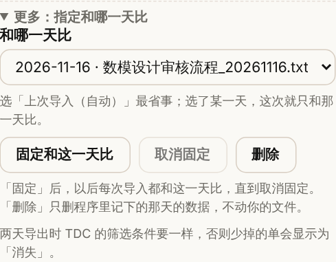

- **只这一次**：在下拉框里选某一天，然后生成。下次仍然自动和上次导入比。
- **以后都和这一天比**：选好后点「固定和这一天比」。之后每次导入都和它比，直到点「取消固定」。

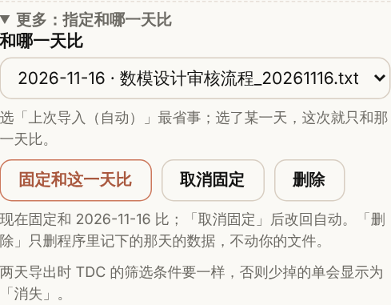

- **删除**：只删掉程序里记下的那天的数据，不动你的报表文件。
- 固定的那一天不受「超过 14 天不比」的限制，摘要里会注明「括号内为较 MM-DD 的变化」。

---

## 三、指定基线文件

适合这种情况：想长期和某一份特定的报表比（比如月初那份），而且希望程序替你留一份备份，原文件被误删、改名也不影响对比。

### 设置步骤

1. 在本地导入区点「指定基线文件」，展开面板：

   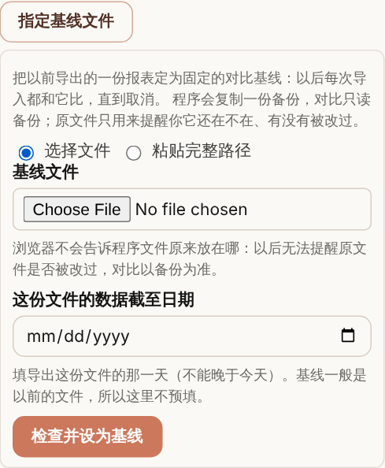

2. 选一种指定方式：

   | 方式 | 怎么做 | 区别 |
   | --- | --- | --- |
   | 选择文件 | 点「选择文件」挑一份报表 | 程序不知道原文件放在哪，之后无法提醒原文件被改名或删除，对比以备份为准 |
   | 粘贴完整路径 | 在文件上按住 Shift 点右键 →「复制文件地址」，粘贴进来（带不带引号都行） | 程序会一直留意原文件还在不在、有没有被改过 |

   可以是电脑上任意位置的 `.xlsx` 或 `.txt` 文件。

3. 填「这份文件的数据截至日期」，也就是导出它的那一天。这里不预填，需要自己填。

   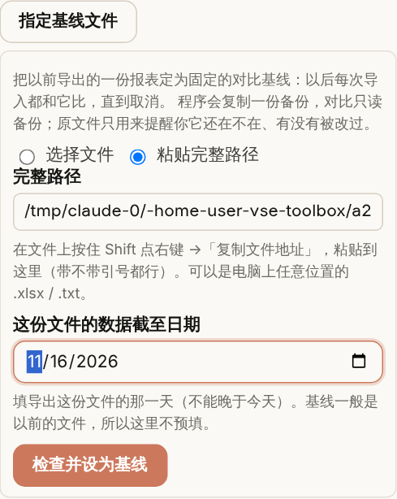

4. 点「检查并设为基线」。程序会当场读一遍文件，没问题就设好，并复制一份备份。

设好之后，面板里会显示当前基线文件、原位置、备份位置和状态：

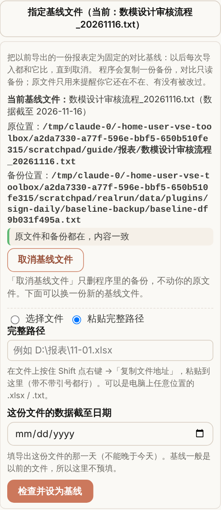

之后每次导入都和这份基线文件比，结果顶部会注明：

### 设置时报错怎么办

路径不对、文件不存在时，会当场提示，不会设置成功：

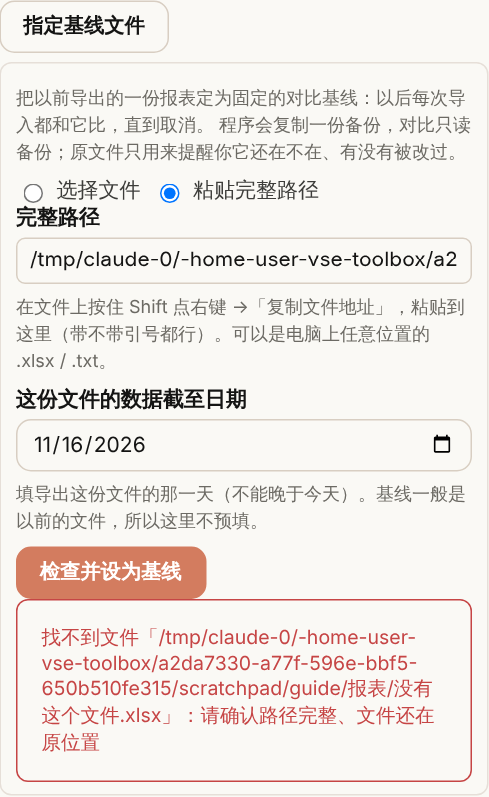

| 提示 | 怎么办 |
| --- | --- |
| 找不到文件 | 确认路径完整、文件还在原位置 |
| 不是完整路径 | 要从盘符开始，例如 `D:\报表\11-01.xlsx` |
| 是文件夹 | 粘贴文件本身的路径，不是它所在的文件夹 |
| 只接受 .xlsx 或 .txt | 换成 TDC 导出的 xlsx，或 Excel 另存的 txt |
| 文件受公司终端加密保护 | 用 Excel 打开，另存为「Unicode 文本(*.txt)」，再把这份 txt 指定为基线 |
| 表头不对 | 文件不是 TDC「数模设计审核流程」的原样导出，重新导出 |
| 数据截至日期晚于今天 | 日期填错了，改成导出那天 |

### 原文件被改名、移动或删除了

程序会提示，并**自动改用备份继续对比**，每日进展照常显示。

导入前，面板和按钮上方都会有黄色提示：

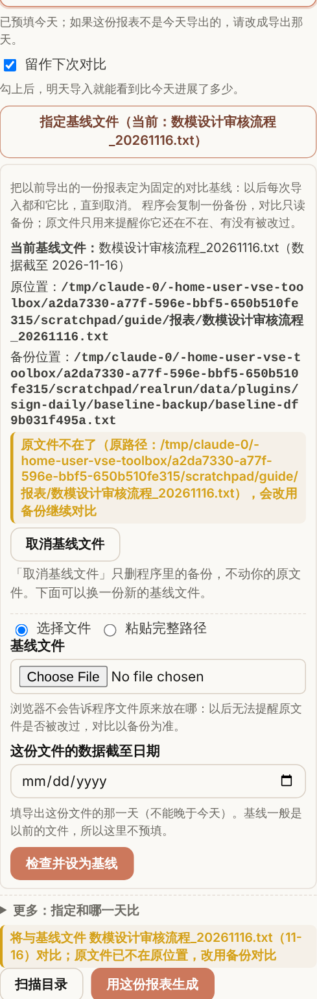

生成后，结果顶部写明「基线文件不存在，已改用备份继续对比」：

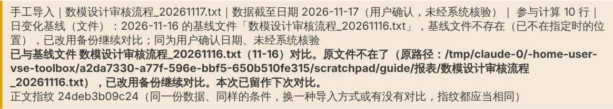

复制出去的正文里只写「基线文件不存在（已不在指定时的位置）」，不会带上你电脑上的路径。

### 原文件被修改过

提示「原文件在指定后被修改过，对比用的是指定时的备份」。对比结果不受影响。
如果想改用文件现在的内容，点面板里的「用现在的文件重新设为基线」。

### 备份也不在了

这时无法对比，按钮上方会变成红色提示：

生成的结果里不显示每日进展，并提示重新指定：

处理办法：打开「指定基线文件」面板，重新指定一份；或点「取消基线文件」，改回自动和上次导入比。

### 其它说明

- **备份放在哪**：程序数据目录下的 `baseline-backup` 文件夹，面板里「备份位置」写着完整路径。只留一份，换基线文件时替换。
- **取消基线文件**：只删程序里的备份，不动你的原文件。取消后改回自动和上次导入比。
- **和「固定和这一天比」二选一**：设了基线文件会取消固定；点固定会取消基线文件并删除备份。两种操作前都会先问你。
- **临时换一天比**：有基线文件时，在「更多：指定和哪一天比」里选某一天，只对那一次生效。
- **基线文件的日期要早于本次数据日期**，否则这次不会对比。

---

## 四、调整图表颜色

生成日报后，左侧「图表配色」面板可以换颜色：

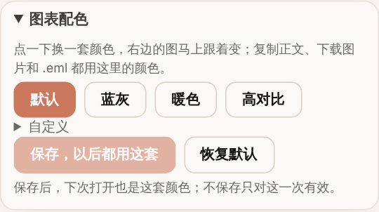

### 一键换方案

点「默认」「蓝灰」「暖色」「高对比」中的任意一个，右边的图马上跟着变。

默认配色：

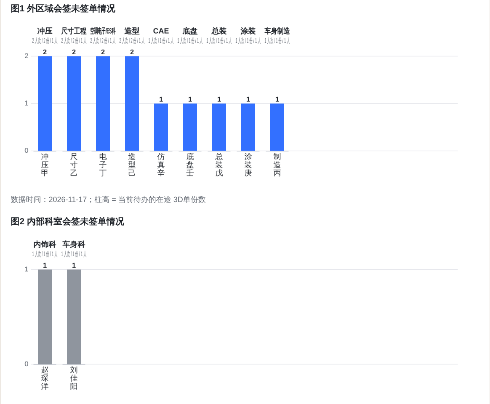

点「暖色」之后：

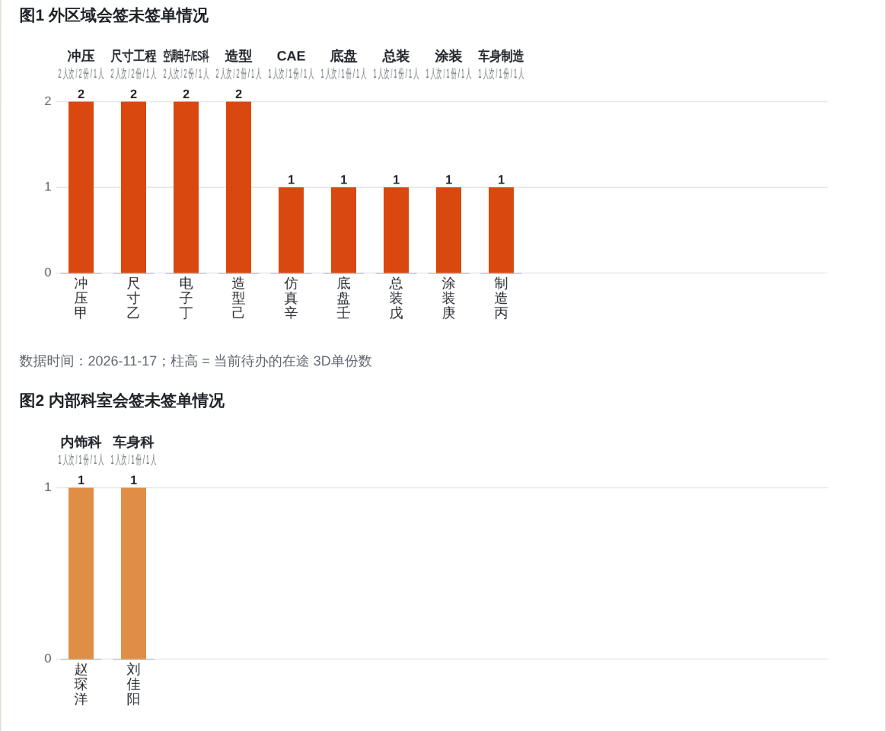

### 自己挑颜色

展开「自定义」，点色块挑颜色：

| 色块 | 管的是什么 |
| --- | --- |
| 图1 外区域柱子 | 图1 的所有柱子 |
| 图2 普通科室 | 图2 里普通科室的柱子 |
| 图2 特殊组 | 图2 里特殊组的柱子 |
| 图3 审批柱子 | 图3 的所有柱子 |

颜色太浅、在白底上可能看不清时会有提醒，但不会拦着你：

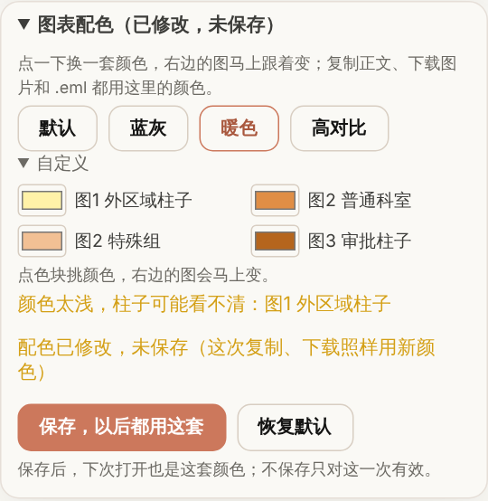

### 保存与恢复

- **不保存也能用**：改完颜色后，这一次的「复制正文」「下载图片」「下载 .eml 草稿」都用新颜色。面板标题会显示「已修改，未保存」。
- **保存，以后都用这套**：下次打开页面也是这套颜色。
- **恢复默认**：换回默认配色并保存，操作前会先确认。
- 配色对「一键生成」的日报和本地导入的日报都生效。

---

## 五、常见问题

**为什么本地导入的日报不能下载 .eml 草稿？**
本地导入的数据日期是你自己确认的，程序无法核验，所以只提供「复制正文」，由你手动发送。

**每日进展里的数字和别人的对不上？**
先确认两边用的是同一份导出、同一个对比日期，以及两次导出的 TDC 筛选条件一致。结果顶部的「正文指纹」可以用来核对：同一份数据、同样的条件，指纹相同。

**本地导入会影响「一键生成」的日报吗？**
不会。本地导入之间互相比较，数据单独存放，不读也不改「一键生成」抓取的数据。

**换了电脑或重装后，之前的导入记录和基线备份还在吗？**
它们存在程序数据目录里。数据目录保留就还在；数据目录被清掉就没有了，需要重新导入和指定。

**离线命令行工具（`tools/sign_daily_local_report.py`）也有每日进展吗？**
没有。命令行工具仍然只算当次，不保存任何数据，也不计算日变化。详见
[本地表单生成流程](签署日报_本地表单生成流程.md)。
